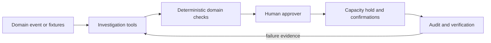

# Reusing ReRoute in another recovery workflow

ReRoute implements a bounded investigation and approval pattern. Reuse requires new domain validation and integration tests; the examples below are future adaptations, not implemented products.

## Swap-in points

| Component | Current implementation | Adaptation work |
|---|---|---|
| Fixtures and event schema | `reroute/fixtures.py`, `fixtures/`, `Store.ingest` | Define real events, stable resource IDs, units, validation, consent and retention |
| Evidence tools | `TOOLS`, `Investigator.call` in `reroute/agent.py` | Replace synthetic inspections with scoped, authenticated read APIs; treat tool output as data |
| Constraints | `check`, `Store._validate` in `reroute/engine.py` | Replace food-specific capacity, handling, travel and window rules; preserve deterministic rejection |
| Approver role | Dispatcher UI and `Store.approve` | Define domain authority and escalation owner; implement identity and authorization server-side |
| Reservation and confirmation | `Store.reserve`, `Store.reply` | Integrate real transactional holds, provider idempotency keys, authenticated callbacks and reconciliation |
| Audit and persistence | SQLite case versions, fingerprints and audit | Adopt durable storage, resource revisions, audit integrity and access control |
| Evaluation | `reroute/evaluation.py`, `tests/` | Supply valid/invalid domain cases, matching baseline, failure and concurrency checks |

## Candidate domains

- **Hospitality:** cancelled event slots; validate room/staff availability and time windows; event manager approves. Guest messaging would require a real integration.
- **Retail and supply:** failed stock delivery; validate vehicle/store capacity and receiving windows; replenishment manager approves.
- **IT infrastructure:** service incident; inspect capacity and ownership; validate technical policy and change windows; an authorized operator approves. Privileged execution requires separate controls.

The current agent is not a general optimizer or a production authorization service. Keep version-specific approval, fresh validation before writes, idempotency and failure evidence. A local dispatcher name must not become an authorization credential in a reused system. Real capacity requires a canonical resource inventory rather than independent fixture snapshots.
